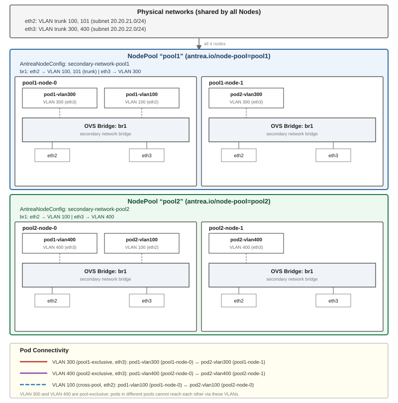

# Antrea Secondary Network Support

## Table of Contents

<!-- toc -->
- [Introduction](#introduction)
- [Prerequisites](#prerequisites)
- [Configurations](#configurations)
  - [VLAN](#vlan)
    - [OVS bridge configuration](#ovs-bridge-configuration)
    - [Secondary VLAN network configuration](#secondary-vlan-network-configuration)
    - [Per-Node OVS bridge configuration with AntreaNodeConfig](#per-node-ovs-bridge-configuration-with-antreanodeconfig)
    - [Pod secondary interface configuration](#pod-secondary-interface-configuration)
  - [SR-IOV](#sr-iov)
    - [Creating network functions](#creating-network-functions)
    - [Installing SR-IOV Network Device Plugin](#installing-sr-iov-network-device-plugin)
    - [Secondary SR-IOV network configuration](#secondary-sr-iov-network-configuration)
    - [Pod secondary interface configuration](#pod-secondary-interface-configuration-1)
- [Limitations](#limitations)
<!-- /toc -->

## Introduction

Antrea can work with Multus, in which case Antrea is the primary CNI of the
Kubernetes cluster and provisions the "primary" network interfaces of Pods;
while Multus manages secondary networks and executes other CNIs to create
secondary network interfaces of Pods. The [Antrea + Multus guide](cookbooks/multus)
talks about how to use Antrea with Multus.

Starting with Antrea v1.5, native support for secondary networks was introduced,
initially for SR-IOV based networks. In Antrea v1.15, support was extended to
include VLAN-based networks. The table below summarizes the capabilities of this
feature across different releases.

| Release       | SR-IOV on Bare-Metal Server | VLAN    | SR-IOV on Virtual Machine |
|---------------|-----------------------------|---------|---------------------------|
| v1.5 - v1.14  | `Alpha`                     |         |                           |
| v1.15 - v2.2  | `Alpha`                     | `Alpha` |                           |
| v2.3 - latest | `Alpha`                     | `Alpha` | `Alpha`                   |

This document describes steps to enable and use Antrea's native support for
secondary networks.

## Prerequisites

Native secondary network support is still an alpha feature and is disabled by
default. To use the feature, the `SecondaryNetwork` feature gate must be enabled
in the `antrea-agent` configuration. If you need IPAM for the secondary
interfaces, you should also enable the `AntreaIPAM` feature gate in both
`antrea-agent` and `antrea-controller` configuration. At the moment, Antrea IPAM
is the only available IPAM option for secondary networks managed by Antrea. The
`antrea-config` ConfigMap with the two feature gates enabled is like the
following:

```yaml
apiVersion: v1
kind: ConfigMap
metadata:
  name: antrea-config
  namespace: kube-system
data:
  antrea-controller.conf: |
    featureGates:
      AntreaIPAM: true
  antrea-agent.conf: |
    featureGates:
      AntreaIPAM: true
      SecondaryNetwork: true
```

Antrea leverages the `NetworkAttachmentDefinition` CRD from [Kubernetes Network
Plumbing Working Group](https://github.com/k8snetworkplumbingwg/multi-net-spec)
to define secondary networks. You can import the CRD to your cluster using the
following command:

```bash
kubectl apply -f https://github.com/k8snetworkplumbingwg/network-attachment-definition-client/raw/master/artifacts/networks-crd.yaml
```

## Configurations

You can configure secondary networks for your Pods using one or more of the
following types:

- [VLAN](#vlan)
- [SR-IOV](#sr-iov)

### VLAN

#### OVS bridge configuration

A VLAN secondary interface will be connected to a separate OVS bridge on the
Node. You can specify the secondary OVS bridge configuration in the
`antrea-agent` configuration, and `antrea-agent` will automatically create the
OVS bridge based on the configuration. The OVS bridge configuration supports
the following parameters:

* `bridgeName` - specifies the name of the OVS bridge to be created. This is a
  required parameter and must be unique on the Node.
* `physicalInterfaces` - a list of physical network interface names to be added
  to the bridge. These interfaces will serve as uplinks for the bridge. At
  least one interface must be specified, and up to eight interfaces are
  supported.
* `enableMulticastSnooping` - (supported after v2.4) enable multicast snooping
  on the bridge, allowing the bridge to learn about multicast group memberships
  and forward multicast traffic only to ports that have interested receivers.
  When disabled, multicast traffic is flooded to all ports in the bridge. The
  default value is `false`.

For example, the following configuration will create an OVS bridge named
`br-secondary`, with a physical interface `eth1`.

```yaml
apiVersion: v1
kind: ConfigMap
metadata:
  name: antrea-config
  namespace: kube-system
data:
  antrea-agent.conf: |
    secondaryNetwork:
      ovsBridges: [{"bridgeName": "br-secondary", "physicalInterfaces": ["eth1"]}]
```

At the moment, Antrea supports only a single OVS bridge for secondary networks,
and supports up to eight physical interfaces on the bridge.

Note: when you set the Node's primary NIC as a secondary bridge physical interface,
if the Node IP is assigned via DHCP and the DNS server is auto-configured by a DNS
manager (e.g. systemd-resolved), you may lose the DNS configuration after the interface
is moved to the OVS bridge due to the interface state change. Please consider providing
a static DNS configuration in `/etc/systemd/resolved.conf` before installing Antrea to
use the primary NIC as a physical interface. Check more details on [issue 6558](https://github.com/antrea-io/antrea/issues/6558).

#### Secondary VLAN network configuration

A secondary VLAN network is defined by a NetworkAttachmentDefinition CR. For
example, the following NetworkAttachmentDefinition defines a VLAN network
`vlan100`.

```yaml
apiVersion: "k8s.cni.cncf.io/v1"
kind: NetworkAttachmentDefinition
metadata:
  name: vlan100
spec:
  config: '{
      "cniVersion": "0.3.0",
      "type": "antrea",
      "networkType": "vlan",
      "mtu": 1500,
      "vlan": 100,
      "ipam": {
        "type": "antrea",
        "ippools": ["vlan100-ipv4", "vlan100-ipv6"]
      }
    }'
```

`antrea-agent` will connect Pod secondary interfaces belonging to a VLAN network
to the secondary OVS bridge on the Node. If a non-zero VLAN is specified in the
network's `config`, `antrea-agent` will configure the VLAN ID on the OVS port,
so the interface's traffic will be isolated within the VLAN. And before the
traffic is forwarded out of the Node via the secondary bridge's physical
interface, OVS will insert the VLAN tag in the packets.

A few extra notes about the NetworkAttachmentDefinition `config` fields:

* `type` - must be set to `antrea`.
* `networkType` - should be set to `vlan` if VLAN-based network is desired.
* `mtu` - defaults to 1500 if not set.
* `vlan` - can be set to 0 or a valid VLAN ID (1 - 4094). Defaults to 0. The
VLAN ID can also be specified as part of the spec of an IPPool referenced in the
`ipam` section, but `vlan` in NetworkAttachmentDefinition `config` will override
the VLAN in IPPool(s) if both are set.
* `ipam` - it is optional. If not set, the secondary interfaces created for the
network won't have an IP address allocated. For more information about secondary
network IPAM configuration, please refer to the [Antrea IPAM document](antrea-ipam.md#ipam-for-secondary-network).

#### Per-Node OVS bridge configuration with AntreaNodeConfig

**Starting with Antrea v2.7.0, the secondary network OVS bridge can be
configured with different settings per Node or Node Pool.**

As an alternative to static configuration via `antrea-agent.conf`, the
AntreaNodeConfig CRD provides a dynamic, per-Node or per-Node-Pool mechanism to
configure the secondary network OVS bridge. This feature is controlled by the
`AntreaNodeConfig` feature gate, which is in `Beta` and enabled by default.

The secondary bridge configuration in an AntreaNodeConfig takes effect only when
`secondaryNetwork.ovsBridges` in the Agent configuration is not set. Static
secondary bridge configuration in `antrea-agent.conf` always takes precedence
over AntreaNodeConfig. If the `AntreaNodeConfig` feature gate is disabled,
AntreaNodeConfig objects are ignored. Changes to the effective AntreaNodeConfig
are reconciled dynamically without an Agent restart.

**Important:** When upgrading an existing installation, applying an
AntreaNodeConfig does not override an existing static secondary bridge
configuration. To migrate from static configuration to AntreaNodeConfig:

1. Apply an AntreaNodeConfig that matches the intended Nodes.
2. Remove the static `secondaryNetwork.ovsBridges` configuration, or set it to
   an empty list.
3. Roll out the `antrea-agent` Pods so that they load the updated Agent
   configuration. After editing the Antrea ConfigMap directly, restart the
   `antrea-agent` DaemonSet. A Helm upgrade triggers this rollout automatically.

The `bridgeName` of an existing AntreaNodeConfig bridge is immutable. To use a
different bridge name, delete and recreate the AntreaNodeConfig. If the
effective bridge configuration changes, existing Pods are not automatically
migrated to the new bridge. Recreate the affected Pods so their secondary
network interfaces can connect to the new bridge.

Antrea Controller summarizes current configuration realization in `AntreaNodeConfig.status`.
Use `kubectl get anc` to see readiness and Node counts. For each Node's actual result,
inspect `AntreaAgentInfo.nodeConfigStatus`. The ANC status contains only aggregate counts
and Conditions, so its size does not grow with the number of selected Nodes.
`status.observedGeneration` identifies the spec version processed by the Controller;
check `Ready=True` for that same generation to determine whether it has been realized.

The common Agent report contains the Node UID, ANC name and UID, and publication heartbeat.
`nodeConfigStatus.secondaryNetwork` contains the current and desired bridges and its `Ready`
Condition. That Condition's `observedGeneration` identifies the reconciled configuration
version; there is no separate report generation or reconciliation timestamp.
Missing or expired reports and unavailable Nodes produce `Ready=Unknown`. A successful
report must match the current Node UID, ANC UID, and generation. Nodes without a report
still count toward `desiredNodes`; they do not count toward `realizedNodes`.

Static configuration overriding an ANC produces `Ready=False` with reason
`OverriddenByStaticConfig`. Aggregate readiness covers the Nodes for which this ANC takes
precedence. `ConflictFree=False` exposes matching Nodes which select an older ANC instead.
Consumers checking an entire nodepool must require both `Ready=True` and `ConflictFree=True`
for the current generation. An ANC with no selected Nodes reports `Ready=False` with reason
`NoMatchingNodes`, or `ConfigurationNotSelected` if all matching Nodes select an older ANC.

To observe secondary network removal, retain the ANC and remove only `spec.secondaryNetwork`.
The same ANC UID and its new generation remain observable while bridge cleanup runs.
While Pod secondary interfaces remain, the Agent rejects new VLAN secondary interfaces
and reports `Ready=False` with reason `BridgeInUse`. Existing interfaces remain available
until removed through the normal Pod or network annotation deletion path. Once the
interfaces are released, host networking is restored, and bridge cleanup succeeds, the
Agent reports `Ready=True`. Operational errors produce `Ready=False` with reason
`ReconcileFailed`; the AgentInfo Condition message contains the error.
Keep the AntreaNodeConfig and SecondaryNetwork features enabled until cleanup completes.

ANC status describes current selected Nodes. It does not retain historical Node ownership
or prevent ANC deletion with a finalizer. Deleting the whole ANC, or removing a nodepool entry
which causes a package manager to delete it, removes the status object before asynchronous
cleanup is necessarily complete. An absent ANC does not prove that its former Nodes have
cleaned up. Selector migration similarly does not wait for formerly selected Nodes.
A package manager which needs removal progress should retain the empty ANC and consume its
current-generation status. Mapping this result into an AddonConfig or nodepool Condition
requires integration in the package or status controller; applying the manifests alone does
not establish network realization. These Conditions also do not test end-to-end connectivity.

**Status examples.** Inspect the aggregate status and an individual Agent's report with:

```bash
kubectl get anc secondary-network-all-linux -o yaml
kubectl get antreaagentinfo node-a -o yaml
```

The following excerpts omit unrelated fields. Assume the ANC selects two Linux Nodes,
`node-a` and `node-b`, and both have realized generation 1. The aggregate status is:

```yaml
apiVersion: crd.antrea.io/v1alpha1
kind: AntreaNodeConfig
metadata:
  name: secondary-network-all-linux
  uid: 11111111-1111-4111-8111-111111111111
  generation: 1
status:
  observedGeneration: 1
  desiredNodes: 2
  realizedNodes: 2
  conditions:
  - type: Ready
    status: "True"
    observedGeneration: 1
    lastTransitionTime: "2026-10-29T09:00:00Z"
    reason: Reconciled
    message: Configuration has been realized on all selected Nodes
  - type: ConflictFree
    status: "True"
    observedGeneration: 1
    lastTransitionTime: "2026-10-29T09:00:00Z"
    reason: NoConflicts
    message: No matching Nodes select another AntreaNodeConfig
```

The corresponding Agent report on `node-a` could be:

```yaml
apiVersion: crd.antrea.io/v1beta1
kind: AntreaAgentInfo
metadata:
  name: node-a
nodeConfigStatus:
  nodeUID: aaaaaaaa-aaaa-4aaa-8aaa-aaaaaaaaaaaa
  configName: secondary-network-all-linux
  configUID: 11111111-1111-4111-8111-111111111111
  lastHeartbeatTime: "2026-10-29T09:01:00Z"
  secondaryNetwork:
    currentBridge: br1
    desiredBridge: br1
    conditions:
    - type: Ready
      status: "True"
      observedGeneration: 1
      lastTransitionTime: "2026-10-29T09:00:00Z"
      reason: Reconciled
      message: Secondary network configuration has been realized
```

`nodeConfigStatus` is a top-level field on AntreaAgentInfo, not a field under `status`.
The Agent publishes reconciliation results on changes and refreshes its heartbeat every
minute. Reports older than three minutes are unavailable even if the last reconciliation
succeeded. Condition transition times are not heartbeat or reconciliation expiry clocks.
After restart, the Agent publishes its new reconciliation result rather than refreshing
the previous Agent's readiness.

Feature readiness is explicit. A disabled feature reports `Ready=False` with reason
`FeatureDisabled`; an unsupported platform reports `UnsupportedNode`. An initializing
feature reports `Ready=Unknown` with reason `ConfigurationUnavailable`. A missing
`secondaryNetwork` object or missing `Ready` Condition is also unavailable, not disabled.
No separate `configurationEnabled` flag is needed.

If static configuration creates `br-secondary` while the ANC requests `br1`, the feature
reports `Ready=False` with reason `OverriddenByStaticConfig`. Its `currentBridge` and
`desiredBridge` refer to the effective static `br-secondary` configuration. If that
configuration fails to reconcile, the Condition message also includes the error.

Suppose `spec.secondaryNetwork` is removed, `node-b` has completed cleanup, and a Pod on
`node-a` still uses `br1`. The retained ANC's aggregate output could be:

```yaml
apiVersion: crd.antrea.io/v1alpha1
kind: AntreaNodeConfig
metadata:
  name: secondary-network-all-linux
  uid: 11111111-1111-4111-8111-111111111111
  generation: 2
spec:
  nodeSelector:
    matchLabels:
      kubernetes.io/os: linux
status:
  observedGeneration: 2
  desiredNodes: 2
  realizedNodes: 1
  conditions:
  - type: Ready
    status: "False"
    observedGeneration: 2
    lastTransitionTime: "2026-10-29T09:05:05Z"
    reason: BridgeInUse
    message: >-
      Node node-a: Waiting for Pod secondary interfaces to be removed before
      deleting the bridge
  - type: ConflictFree
    status: "True"
    observedGeneration: 2
    lastTransitionTime: "2026-10-29T09:00:00Z"
    reason: NoConflicts
    message: No matching Nodes select another AntreaNodeConfig
```

The AgentInfo for `node-a` identifies the same configuration UID. Its `secondaryNetwork`
object has `currentBridge: br1`, no desired bridge, and `Ready=False` with reason
`BridgeInUse` and `observedGeneration: 2`.
After the Pod interface is removed and cleanup succeeds, `realizedNodes` becomes 2 and
`Ready=True`. The empty ANC remains available for the package manager to inspect.

The AntreaNodeConfig CRD spec includes the following fields:

- `nodeSelector` - standard Kubernetes `LabelSelector` that selects the Nodes to
  which this configuration applies. Required.
- `secondaryNetwork.ovsBridges[]` - list of OVS bridge configurations; at most
  one bridge is currently supported. Each entry has:
  - `bridgeName` - name of the OVS bridge. Required and immutable.
  - `physicalInterfaces[]` - optional list of physical interfaces to connect to
    the bridge. Up to eight interfaces are supported. Each entry has:
    - `name` - interface name. Required.
    - `allowedVLANs` - optional list of VLAN IDs or ranges (e.g. `"100"`,
      `"200-300"`) that are permitted on this interface. When set, the port is
      configured as a trunk port (carrying traffic for multiple VLANs),
      restricted to the listed VLANs. When omitted, all VLANs are allowed.
  - `enableMulticastSnooping` - enable multicast snooping on the bridge
    (defaults to `false`).

**Selection precedence**: if multiple AntreaNodeConfig CRs match a Node, the
oldest one (determined by `creationTimestamp`, with `name` as a tiebreaker)
takes effect.

**Example 1** — apply a single-interface bridge to all Linux Nodes:

```yaml
apiVersion: crd.antrea.io/v1alpha1
kind: AntreaNodeConfig
metadata:
  name: secondary-network-all-linux
spec:
  nodeSelector:
    matchLabels:
      kubernetes.io/os: "linux"
  secondaryNetwork:
    ovsBridges:
      - bridgeName: br-secondary
        physicalInterfaces:
          - name: eth1
```

**Example 2** — different configuration per NodePool with VLAN filtering:

```yaml
apiVersion: crd.antrea.io/v1alpha1
kind: AntreaNodeConfig
metadata:
  name: secondary-network-pool1
spec:
  nodeSelector:
    matchLabels:
      antrea.io/node-pool: "pool1"
  secondaryNetwork:
    ovsBridges:
      - bridgeName: br1
        physicalInterfaces:
          - name: eth2
            allowedVLANs: ["100", "101"]
          - name: eth3
            allowedVLANs: ["300"]
        enableMulticastSnooping: false
---
apiVersion: crd.antrea.io/v1alpha1
kind: AntreaNodeConfig
metadata:
  name: secondary-network-pool2
spec:
  nodeSelector:
    matchLabels:
      antrea.io/node-pool: "pool2"
  secondaryNetwork:
    ovsBridges:
      - bridgeName: br1
        physicalInterfaces:
          - name: eth2
            allowedVLANs: ["100"]
          - name: eth3
            allowedVLANs: ["400"]
        enableMulticastSnooping: false
```

In this example the two node pools share the same bridge name `br1` but restrict
different VLANs on physical interfaces - `pool1` Nodes configure VLAN 100 and 101 on
`eth2`, and VLAN 300 on `eth3`; while `pool2` Nodes configure VLAN 100 on `eth2`
and VLAN 400 on `eth3`.

The following topology diagram shows the resulting bridges when the two AntreaNodeConfig
CRs above match two node pools respectively. The example cluster has 4 worker Nodes:
the first two (sorted by name) are labelled `pool1` and the other two are labelled
with `pool2`. Every Node is connected to the shared VLAN-aware physical networks
via `eth2` and `eth3`.



To attach Pods to one of those pool-specific networks, first define the corresponding
`NetworkAttachmentDefinition` and `IPPool` CRs, then schedule Pods onto the matching
node pools. The following example creates one Pod that uses VLAN 300 on a `pool1` node
and another Pod that uses VLAN 400 on a `pool2` node:

```yaml
# NetworkAttachmentDefinition + IPPool for pool1 VLAN 300 (via eth3)
apiVersion: crd.antrea.io/v1beta1
kind: IPPool
metadata:
  name: pool1-vlan300-ipv4
spec:
  ipRanges:
    - cidr: "10.10.30.0/24"
  subnetInfo:
    gateway: "10.10.30.1"
    prefixLength: 24
---
apiVersion: k8s.cni.cncf.io/v1
kind: NetworkAttachmentDefinition
metadata:
  name: vlan-pool1-300
spec:
  config: '{
      "cniVersion": "0.3.0",
      "type": "antrea",
      "networkType": "vlan",
      "vlan": 300,
      "ipam": {"type": "antrea", "ippools": ["pool1-vlan300-ipv4"]}
    }'
---
# NetworkAttachmentDefinition + IPPool for pool2 VLAN 400 (via eth3)
apiVersion: crd.antrea.io/v1beta1
kind: IPPool
metadata:
  name: pool2-vlan400-ipv4
spec:
  ipRanges:
    - cidr: "10.10.40.0/24"
  subnetInfo:
    gateway: "10.10.40.1"
    prefixLength: 24
---
apiVersion: k8s.cni.cncf.io/v1
kind: NetworkAttachmentDefinition
metadata:
  name: vlan-pool2-400
spec:
  config: '{
      "cniVersion": "0.3.0",
      "type": "antrea",
      "networkType": "vlan",
      "vlan": 400,
      "ipam": {"type": "antrea", "ippools": ["pool2-vlan400-ipv4"]}
    }'
---
# Pod on pool1 — secondary interface on VLAN 300
apiVersion: v1
kind: Pod
metadata:
  name: pod-pool1-vlan300
  annotations:
    k8s.v1.cni.cncf.io/networks: '[{"name": "vlan-pool1-300", "interface": "eth1"}]'
spec:
  nodeSelector:
    antrea.io/node-pool: "pool1"
  containers:
    - name: toolbox
      image: antrea/toolbox:latest
---
# Pod on pool2 — secondary interface on VLAN 400
apiVersion: v1
kind: Pod
metadata:
  name: pod-pool2-vlan400
  annotations:
    k8s.v1.cni.cncf.io/networks: '[{"name": "vlan-pool2-400", "interface": "eth1"}]'
spec:
  nodeSelector:
    antrea.io/node-pool: "pool2"
  containers:
    - name: toolbox
      image: antrea/toolbox:latest
```

The `nodeSelector` on each Pod ensures it is scheduled onto a Node that has the
matching AntreaNodeConfig applied, so the `br1` bridge with the correct VLAN
configuration is already in place when the Pod starts.

#### Pod secondary interface configuration

You can create a Pod with secondary network interfaces by adding the
`k8s.v1.cni.cncf.io/networks` annotation to the Pod. The following example Pod
includes two secondary interfaces, one in network `vlan100` which should be
created in the same Namespace as the Pod, the other in network `vlan200` which
is created in Namespace `networks`.

```yaml
apiVersion: v1
kind: Pod
metadata:
  name: sample-pod-secondary-network-vlan
  annotations:
    k8s.v1.cni.cncf.io/networks: '[
      {"name": "vlan100"},
      {"name": "vlan200", "namespace": "networks", "interface": "eth200"}
    ]'
spec:
  containers:
  - name: toolbox
    image: antrea/toolbox:latest
```

You can also pass the static MAC address for secondary interfaces in annotation.

```yaml
apiVersion: v1
kind: Pod
metadata:
  name: sample-pod-secondary-network-vlan
  annotations:
    k8s.v1.cni.cncf.io/networks: '[
      {"name": "vlan100"},
      {"name": "vlan200", "namespace": "networks", "interface": "eth200", "mac": "6a:08:cb:4b:ff:d3"}
    ]'
spec:
  containers:
  - name: toolbox
    image: antrea/toolbox:latest
```

If the Pod has only a single secondary network interface, you can also set
the `k8s.v1.cni.cncf.io/networks` annotation to `<network-name>`,
or `<namespace>/<network-name>` if the NetworkAttachmentDefinition CR is created
in a different Namespace from the Pod's Namespace, or
`<network-name>@<interface-name>` if you want to specify the Pod interface name.
For example:

```yaml
apiVersion: v1
kind: Pod
metadata:
  name: sample-pod-secondary-network-vlan
  annotations:
    k8s.v1.cni.cncf.io/networks: networks/vlan200@eth200
spec:
  containers:
  - name: toolbox
    image: antrea/toolbox:latest
```

You can remove the annotation `k8s.v1.cni.cncf.io/networks` to delete
the secondary interfaces. Network updates are not supported. Please check
the [Limitations](#limitations) section for more details.

### SR-IOV

#### Creating network functions

To configure SR-IOV network for Pods, the required network functions must be
available on the Kubernetes Node, whether it is a virtual machine or a
bare-metal server. You can follow the docs below to create SR-IOV Virtual
Functions (VFs) or Subfunctions (SFs).

* [Creating SR-IOV Virtual Functions](https://github.com/k8snetworkplumbingwg/sriov-network-device-plugin/blob/master/docs/vf-setup.md)
* [Creating Subfunctions](https://github.com/k8snetworkplumbingwg/sriov-network-device-plugin/blob/master/docs/subfunctions/README.md)

**While the implementation is designed to work with all SR-IOV capable NICs,
we currently lack the resources to test every model, particularly those with
SFs. Please open an issue if you encounter issues with a specific NIC.**

#### Installing SR-IOV Network Device Plugin

After creating network functions, you need to install the [SR-IOV Network
Device Plugin](https://github.com/k8snetworkplumbingwg/sriov-network-device-plugin),
a Kubernetes device plugin that discovers and advertises networking resources,
including SR-IOV VFs and SFs, on a Kubernetes Node. You can follow [this doc](https://github.com/k8snetworkplumbingwg/sriov-network-device-plugin?tab=readme-ov-file#install-sr-iov-network-device-plugin)
to install the plugin.

On successful installation, the allocatable resource list for the Node should
be updated with network resources discovered by the plugin, as shown below:

```bash
$ kubectl get node node1 -o json | jq '.status.allocatable'
{
  "cpu": "8",
  "ephemeral-storage": "169986638772",
  "hugepages-1Gi": "0",
  "hugepages-2Mi": "8Gi",
  "intel.com/sriov_net_A": "8",
  "intel.com/sriov_net_B": "8",
  "memory": "7880620Ki",
  "pods": "1k"
}
```

#### Secondary SR-IOV network configuration

You can now define a secondary SR-IOV network using a
NetworkAttachmentDefinition of `sriov` network type, which references the
discovered network resource. For example, the following
NetworkAttachmentDefinition defines a SR-IOV network named `sriov-net-a`, linked
to the network resource `intel.com/sriov_net_A`:

```yaml
apiVersion: "k8s.cni.cncf.io/v1"
kind: NetworkAttachmentDefinition
metadata:
  name: sriov-net-a
  annotations:
    k8s.v1.cni.cncf.io/resourceName: intel.com/sriov_net_A
spec:
  config: '{
      "cniVersion": "0.3.0",
      "type": "antrea",
      "networkType": "sriov",
      "ipam": {
        "type": "antrea",
        "ippools": ["sriov-ipv4"]
      }
    }'
```

A few extra notes about the NetworkAttachmentDefinition `config` fields:

* `type` - must be set to `antrea`.
* `networkType` - should be set to `sriov` if SR-IOV based network is desired.
* `mtu` - defaults to 1500 if not set.
* `ipam` - it is optional. If not set, the secondary interfaces created for the
  network won't have an IP address allocated. For more information about secondary
  network IPAM configuration, please refer to the [Antrea IPAM document](antrea-ipam.md#ipam-for-secondary-network).

#### Pod secondary interface configuration

Finally, to create a Pod with a secondary SR-IOV interface, add the
`k8s.v1.cni.cncf.io/networks` annotation to the Pod, specifying the desired
SR-IOV network.

```yaml
apiVersion: v1
kind: Pod
metadata:
  name: sample-pod-secondary-network-sriov
  annotations:
    k8s.v1.cni.cncf.io/networks: sriov-net-a
spec:
  containers:
  - name: toolbox
    image: antrea/toolbox:latest
    resources:
      requests:
        intel.com/sriov_net_A: '1'
      limits:
        intel.com/sriov_net_A: '1'
```

Similar to the VLAN network configuration, you can remove the annotation
`k8s.v1.cni.cncf.io/networks` to delete the secondary interfaces.
Network updates are not supported. Please check the [Limitations](#limitations)
section for more details.

## Limitations

* At the moment, Antrea does NOT support annotation updates: when the annotation is
  added to the Pod for the first time (e.g., when creating the Pod), Antrea will
  configure the secondary network interfaces accordingly, and no change is
  possible after that, until the Pod is deleted. Removing the annotation is
  supported and will delete the secondary interfaces.
* Antrea does not support K8s Nodes with multi-path routes.
  > A multi-path route is a route with multiple possible next hops. When listing the
  > rules (e.g., with `ip route list`), a multi-path route may appear as multiple individual
  > routes (one for each next hop), all with the same cost.

  When the K8s Node interfaces are managed by a network manager, please make sure the default
  routes for secondary interfaces are disabled, or configure the routes with different metrics.
  Otherwise, you may encounter K8s Node connection issues. Please check issue [#7058](https://github.com/antrea-io/antrea/issues/7058) for details.
